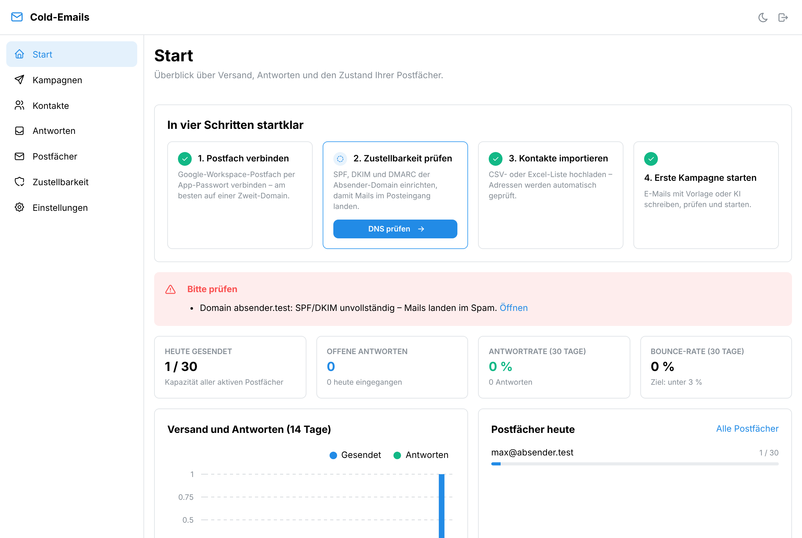
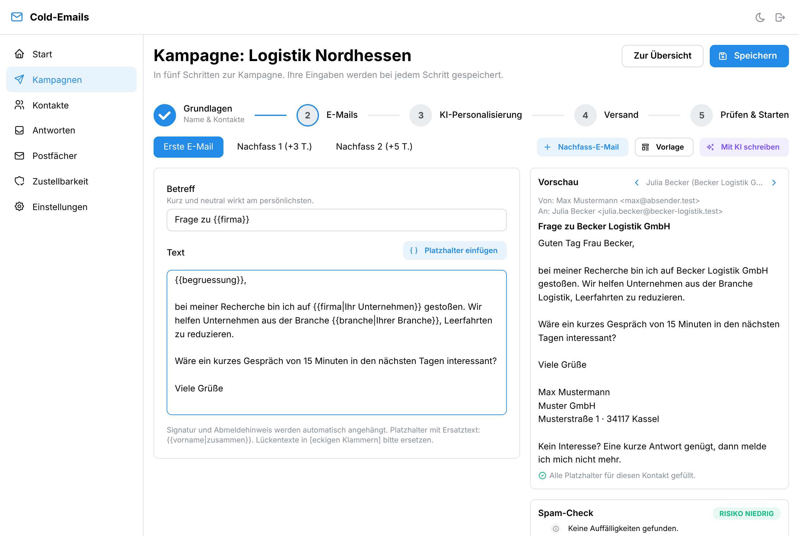
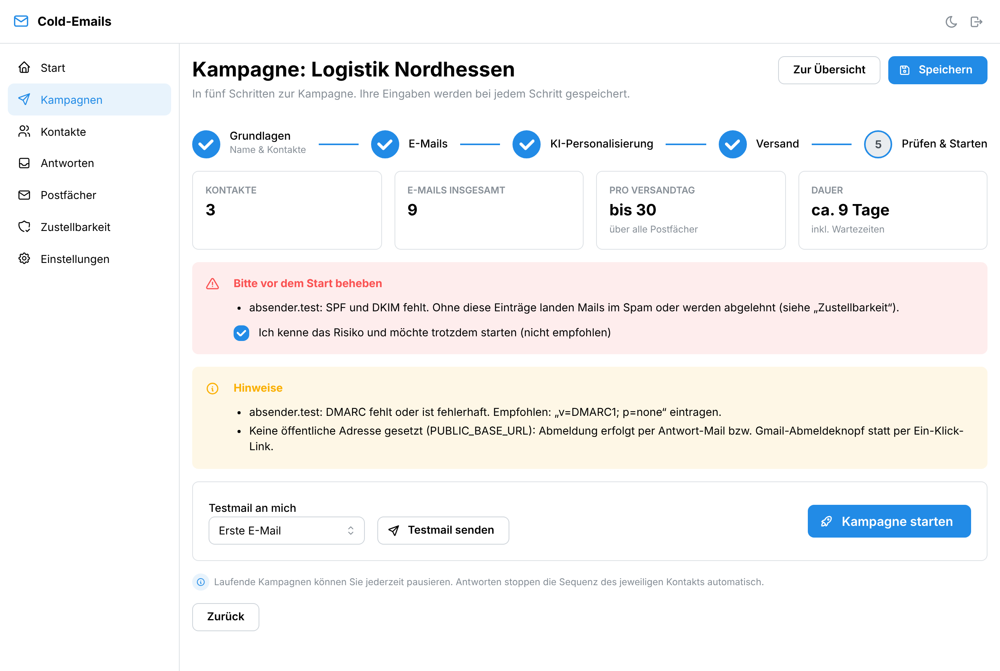
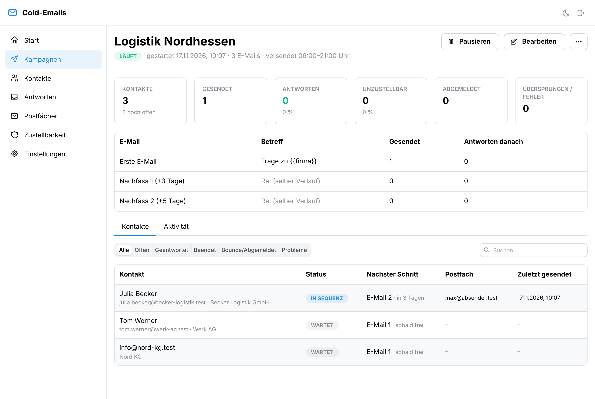
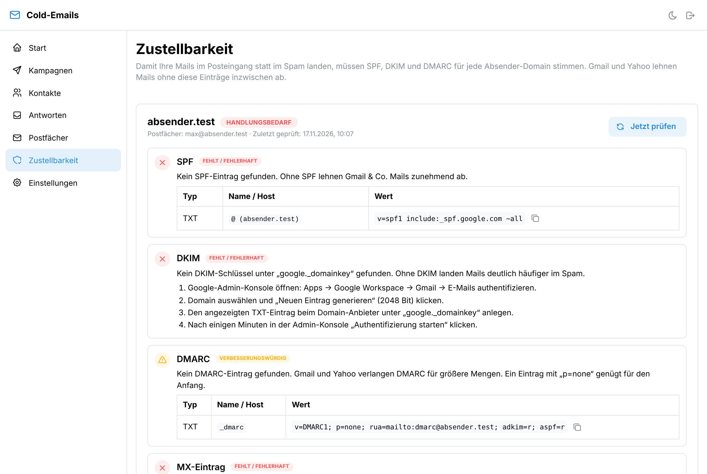

# Cold-Emails

Selbst gehostete Plattform für **personalisierte Cold-Emails, die im Posteingang ankommen** – über Ihre eigenen Google-Workspace-Postfächer, mit KI-Personalisierung durch Claude und einer deutschen Oberfläche, die in wenigen Minuten verstanden ist.



## Inhalt

- [Was die Plattform kann](#was-die-plattform-kann)
- [Wichtig: Rechtliches](#wichtig-rechtliches)
- [Installation](#installation)
- [Einrichtung in vier Schritten](#einrichtung-in-vier-schritten)
- [KI mit Claude](#ki-mit-claude)
- [So bleiben Ihre Mails aus dem Spam](#so-bleiben-ihre-mails-aus-dem-spam)
- [Platzhalter](#platzhalter)
- [Betrieb: Backup, Updates, Protokolle](#betrieb-backup-updates-protokolle)
- [Konfiguration (.env)](#konfiguration-env)
- [Fehlerbehebung](#fehlerbehebung)
- [Entwicklung](#entwicklung)

## Was die Plattform kann

**Versand über eigene Postfächer**
- Google Workspace per App-Passwort oder „Mit Google verbinden“ (OAuth), alternativ jeder SMTP/IMAP-Anbieter
- Beliebig viele Postfächer; die Mails einer Kampagne werden automatisch verteilt, Nachfass-Mails kommen immer vom selben Postfach
- Gesendete Mails liegen wie gewohnt in Gmail unter „Gesendet“, Antworten im Posteingang

**Zustellbarkeit (nicht im Spam landen)**
- Prüfung von SPF, DKIM und DMARC je Domain mit fertigen DNS-Einträgen zum Kopieren; ohne SPF/DKIM startet keine Kampagne
- Tageslimit je Postfach und langsames Hochfahren neuer Postfächer (z. B. 5 → 30 Mails pro Tag)
- Versand nur im Zeitfenster (z. B. werktags 8–17 Uhr), mit natürlichen, zufälligen Abständen über den Tag verteilt
- Reiner Text, kein Tracking-Pixel, keine umgeschriebenen Links
- Abmeldehinweis in jeder Mail und `List-Unsubscribe`-Kopfzeile (Gmail-Knopf „Abbestellen“, Ein-Klick-Abmeldung nach RFC 8058)
- Automatische Pause bei mehr als 5 % unzustellbaren Mails; Bounces und Abmeldungen landen sofort auf der Sperrliste

**Personalisierung**
- Platzhalter wie `{{vorname}}`, `{{firma}}` oder `{{begruessung}}` („Guten Tag Frau Becker“ bzw. „Hallo Julia“), beliebige eigene Spalten, Ersatztexte wie `{{vorname|zusammen}}`
- Persönlicher KI-Einstieg je Kontakt (Claude), auf Wunsch mit Blick auf die Website des Kontakts – Sie prüfen und geben frei, bevor etwas verschickt wird
- KI-Schreibhilfe: komplette Sequenzen aus wenigen Angaben, Texte verbessern
- Live-Vorschau mit echten Kontakten und lokaler Spam-Check beim Schreiben

**Automatik**
- Sequenzen aus Erstkontakt und Nachfass-Mails im selben E-Mail-Verlauf („Re: …“)
- Antworten stoppen die Sequenz automatisch – auch wenn ein Kollege antwortet
- Abwesenheitsnotizen werden erkannt; die nächste Mail kommt erst nach der Rückkehr
- Antworten werden von der KI eingeordnet (interessiert, später, kein Interesse, Abmeldung …)

| Kampagnen-Editor mit Vorschau | Prüfen & Starten |
|---|---|
|  |  |
| **Kampagne im Versand** | **Zustellbarkeit** |
|  |  |

## Wichtig: Rechtliches

> Dieser Abschnitt ist keine Rechtsberatung.

- **Deutschland:** Werbung per E-Mail ist nach § 7 Abs. 2 Nr. 2 UWG grundsätzlich nur mit vorheriger ausdrücklicher Einwilligung erlaubt – **auch gegenüber Unternehmen (B2B)**. Verstöße können abgemahnt werden. Österreich und die Schweiz haben ähnlich strenge Regeln, andere Länder eigene Vorgaben. Bitte lassen Sie Ihr Vorgehen rechtlich prüfen.
- **DSGVO:** Für die Kontaktdaten brauchen Sie eine Rechtsgrundlage und müssen die Betroffenen informieren (Art. 14 DSGVO). Mit Google (Postfächer) und Anthropic (KI-Funktionen) sollten Auftragsverarbeitungsverträge bestehen.
- **Pflichtangaben:** Geschäftliche E-Mails brauchen Impressumsangaben. Hinterlegen Sie sie unter *Einstellungen → Firma & Impressum* und übernehmen Sie sie in die Signatur.

Die Plattform unterstützt Sie bei diesen Pflichten (Abmeldung in jeder Mail, Sperrliste, Signatur mit Pflichtangaben, Daten bleiben auf Ihrem Server), kann aber unerlaubte Werbung nicht zulässig machen.

## Installation

Sie brauchen nur **Docker**. Die Plattform läuft danach dauerhaft im Hintergrund; alle Daten liegen in einer SQLite-Datei auf Ihrem Rechner bzw. Server.

### A) Auf einem Server mit HTTPS (empfohlen)

Ein kleiner Server (z. B. 2 GB RAM, Ubuntu, Docker installiert) läuft rund um die Uhr – Kampagnen laufen also auch nachts und am Wochenende weiter, wenn Ihr Laptop aus ist. Für HTTPS brauchen Sie eine (Sub-)Domain, deren A-Record auf den Server zeigt, z. B. `mail.ihre-firma.de`.

```bash
git clone https://github.com/Fabian9876543/Cold-Emails.git
cd Cold-Emails
cp .env.example .env
nano .env        # ADMIN_PASSWORD, PUBLIC_BASE_URL=https://mail.ihre-firma.de, DOMAIN=mail.ihre-firma.de
docker compose --profile https up -d --build
```

Danach erreichen Sie die Plattform unter `https://mail.ihre-firma.de`. Das Zertifikat besorgt Caddy automatisch (Let's Encrypt). Mit `PUBLIC_BASE_URL` enthalten die Mails außerdem einen Ein-Klick-Abmeldelink.

### B) Lokal auf dem eigenen Rechner

Mit [Docker Desktop](https://www.docker.com/products/docker-desktop/):

```bash
cp .env.example .env    # mindestens ADMIN_PASSWORD setzen
docker compose up -d --build
```

Dann `http://localhost:3000` öffnen. Hinweis: Versendet wird nur, solange der Rechner läuft.

### C) Ohne Docker (Node.js ≥ 22.12)

```bash
cp .env.example .env
npm ci
npm run build
npm start               # http://localhost:3000
```

## Einrichtung in vier Schritten

Die Startseite der Plattform führt Sie mit einer Checkliste durch diese Schritte.

### 1. Postfach verbinden

**Tipp:** Verschicken Sie Cold-Emails von einer **eigenen Zweit-Domain** (z. B. `ihre-firma-mail.de`, in Google Workspace als zusätzliche Domain eingerichtet). So bleibt der Ruf Ihrer Hauptdomain geschützt.

**Variante 1 – App-Passwort (ca. 2 Minuten je Postfach):**
1. Mit dem Postfach bei Google anmelden und die [Bestätigung in zwei Schritten](https://myaccount.google.com/signinoptions/twosv) aktivieren.
2. Ein [App-Passwort erstellen](https://myaccount.google.com/apppasswords) (Name z. B. „Cold-Emails“) und das 16-stellige Passwort kopieren.
3. In der Plattform unter *Postfächer → Postfach verbinden* einfügen. Die Verbindung wird sofort geprüft.

Workspace-Admins: In der Admin-Konsole müssen App-Passwörter (Bestätigung in zwei Schritten) und der IMAP-Zugriff (*Apps → Google Workspace → Gmail → Endnutzerzugriff*) erlaubt sein.

**Variante 2 – „Mit Google verbinden“ (ohne Passwörter):** Einmalig eine interne OAuth-App in der Google Cloud Console anlegen – die Schritt-für-Schritt-Anleitung samt Weiterleitungs-URI finden Sie in der Plattform unter *Einstellungen → „Mit Google verbinden“*. Danach werden Postfächer mit einem Klick verbunden.

### 2. Zustellbarkeit prüfen (DNS)

Unter *Zustellbarkeit* prüft die Plattform jede Absender-Domain und zeigt fehlende Einträge zum Kopieren an. Typisch für Google Workspace:

| Eintrag | Typ | Name | Wert |
|---|---|---|---|
| SPF | TXT | `@` | `v=spf1 include:_spf.google.com ~all` |
| DKIM | TXT | `google._domainkey` | Schlüssel aus der Google-Admin-Konsole (*Apps → Google Workspace → Gmail → E-Mails authentifizieren*) |
| DMARC | TXT | `_dmarc` | `v=DMARC1; p=none; rua=mailto:dmarc@ihre-domain.de` |

Danach lohnt sich eine Testmail an sich selbst: In Gmail unter *⋮ → Original anzeigen* sollten SPF, DKIM und DMARC auf **PASS** stehen.

### 3. Kontakte importieren

CSV (Komma oder Semikolon, auch Excel-Export mit Umlauten) oder Excel (`.xlsx`). Die erste Zeile enthält die Spaltennamen; die Zuordnung erkennt deutsche und englische Bezeichnungen automatisch.

```text
E-Mail;Anrede;Vorname;Nachname;Firma;Position;Website;Branche
julia.becker@becker-logistik.de;Frau;Julia;Becker;Becker Logistik GmbH;Geschäftsführerin;becker-logistik.de;Logistik
```

Beim Import werden ungültige Adressen, Wegwerf-Adressen und Domains ohne Mailempfang aussortiert, Duplikate zusammengeführt und die Sperrliste beachtet. Zusätzliche Spalten (hier „Branche“) werden zu Platzhaltern wie `{{branche}}`.

### 4. Kampagne erstellen und starten

Der Assistent führt durch **Grundlagen → E-Mails → KI-Personalisierung → Versand → Prüfen & Starten**. Vor dem Start prüft die Plattform alles Wichtige: DNS, Platzhalter, nicht ausgefüllte Lückentexte, Abmeldehinweis, Postfächer. Außerdem schätzt sie, wie lange die Kampagne dauert. Schicken Sie sich vorher eine Testmail.

## KI mit Claude

- **Einrichten:** API-Schlüssel auf [console.anthropic.com](https://console.anthropic.com/settings/keys) erstellen und unter *Einstellungen → KI mit Claude* hinterlegen (verschlüsselt gespeichert) oder als `ANTHROPIC_API_KEY` in die `.env` schreiben.
- **Modell:** Standardmäßig wird automatisch das neueste Opus-Modell verwendet (beste Textqualität). In den Einstellungen können Sie ein günstigeres Modell wählen, z. B. aus der Sonnet- oder Haiku-Familie.
- **Kosten:** Vor dem Erstellen der Einstiege zeigt die Plattform eine Kostenschätzung an. Für große Listen gibt es den **Batch-Modus** (50 % günstiger, Ergebnis meist innerhalb einer Stunde). Die geschätzten Kosten je Monat stehen in den Einstellungen; maßgeblich ist Ihre Abrechnung bei Anthropic.
- **Qualität und Kontrolle:** Die KI darf nur Fakten aus Ihren Kontaktdaten und der Website verwenden. Einstiege mit Links, Platzhaltern oder Begrüßung werden verworfen. Sie prüfen jeden Einstieg in einer Freigabe-Tabelle (oder schalten die automatische Freigabe bewusst ein).
- **Datenschutz:** Für die KI-Funktionen werden Kontaktdaten (Name, Firma, Position, eigene Spalten, Website-Auszug) und Antworttexte an Anthropic übermittelt.

## So bleiben Ihre Mails aus dem Spam

1. **SPF, DKIM, DMARC** vollständig einrichten (siehe oben).
2. **Kleine Mengen je Postfach:** 20–40 Cold-Emails pro Tag. Für mehr Volumen weitere Postfächer verbinden, nicht das Limit erhöhen. Beispiel: 500 Mails pro Tag ≈ 15 Postfächer auf 3–5 Domains.
3. **Neue Postfächer hochfahren** lassen (Standardeinstellung).
4. **Reiner, kurzer Text** (50–125 Wörter), im Erstkontakt möglichst ohne Links, keine Link-Kürzer, keine Werbefloskeln – der Spam-Check im Editor hilft.
5. **Echte Personalisierung** statt identischer Massentexte.
6. **Saubere Listen:** Bounce-Raten über 3 % schaden dem Ruf; ab 5 % pausiert die Plattform automatisch.
7. **Ruf beobachten** in den [Google Postmaster Tools](https://postmaster.google.com); Testmails z. B. mit [mail-tester.com](https://www.mail-tester.com) prüfen.

## Platzhalter

| Platzhalter | Inhalt |
|---|---|
| `{{begruessung}}` | „Guten Tag Frau Becker“ (Sie) bzw. „Hallo Julia“ (Du), mit sinnvollem Ersatz bei fehlenden Angaben |
| `{{anrede}}`, `{{vorname}}`, `{{nachname}}` | Angaben zum Kontakt |
| `{{firma}}`, `{{position}}`, `{{website}}`, `{{email}}` | Angaben zum Kontakt |
| `{{ki_einstieg}}` | Persönlicher KI-Einstieg (mit Ersatztext: `{{ki_einstieg\|ich bin auf Ihr Unternehmen gestoßen.}}`) |
| `{{absender_name}}`, `{{absender_vorname}}`, `{{absender_email}}` | Angaben zum Postfach |
| `{{signatur}}` | Signatur des Postfachs (wird sonst automatisch angehängt) |
| `{{abmelden_link}}` | Abmelde-Link (ohne öffentliche Adresse: E-Mail-Link) |
| `{{eigene_spalte}}` | Jede zusätzliche Spalte aus dem Import, z. B. `{{branche}}` |
| `{{kalender_link}}` usw. | Eigene, globale Platzhalter aus den Einstellungen |

Fehlt einem Kontakt eine Angabe ohne Ersatztext, wird er übersprungen und markiert – es geht nie ein „Hallo {{vorname}}“ hinaus.

## Betrieb: Backup, Updates, Protokolle

- **Daten:** Alles liegt im Docker-Volume `cold_emails_data`: die Datenbank `cold-emails.db` und der Schlüssel `app-secret.key`, mit dem Passwörter und Tokens verschlüsselt sind. Bewahren Sie beides zusammen und sicher auf.
- **Backup:**
  ```bash
  docker compose exec app node -e "require('better-sqlite3')('/app/data/cold-emails.db').backup('/app/data/backup.db').then(()=>console.log('ok'))"
  docker compose cp app:/app/data ./backup-$(date +%F)
  ```
- **Update:** `git pull && docker compose up -d --build` (Datenbank-Migrationen laufen automatisch).
- **Protokolle:** `docker compose logs -f app`. Ereignisse wie Bounces, Pausen und Fehler sehen Sie auch direkt in der Plattform (Kampagne → Aktivität).
- **Neustarts sind sicher:** Eine Mail, deren Versand durch einen Neustart unterbrochen wurde, wird nie automatisch erneut gesendet, sondern zur Prüfung markiert.

## Konfiguration (.env)

| Variable | Pflicht | Bedeutung |
|---|---|---|
| `ADMIN_PASSWORD` | ja | Passwort für die Anmeldung (mindestens 8 Zeichen) |
| `PUBLIC_BASE_URL` | empfohlen auf Servern | Öffentliche Adresse, z. B. `https://mail.ihre-firma.de` – für Ein-Klick-Abmeldelinks und „Mit Google verbinden“ |
| `DOMAIN` | nur mit Caddy | Domain für das automatische HTTPS-Zertifikat |
| `ANTHROPIC_API_KEY` | nein | Claude-API-Schlüssel (alternativ in den Einstellungen) |
| `CLAUDE_MODEL` | nein | Festes Modell; leer = automatisch das neueste Opus-Modell |
| `GOOGLE_CLIENT_ID`, `GOOGLE_CLIENT_SECRET` | nein | OAuth-App für „Mit Google verbinden“ (alternativ in den Einstellungen) |
| `APP_SECRET` | nein | Eigenes Verschlüsselungsgeheimnis; leer = wird beim ersten Start erzeugt |
| `PORT` | nein | Port der Plattform (Standard 3000) |

## Fehlerbehebung

**„Google hat die Anmeldung abgelehnt“** – Bestätigung in zwei Schritten aktiv? App-Passwort (16 Zeichen) statt normalem Passwort verwendet? Erlaubt der Workspace-Admin App-Passwörter und IMAP?

**Es wird nichts verschickt** – Läuft die Kampagne (Status „Läuft“)? Liegt die aktuelle Uhrzeit im Versandfenster und ist heute ein Versandtag? Ist das Tageslimit des Postfachs erreicht (*Postfächer*)? Warten KI-Einstiege noch auf Freigabe? Neue Postfächer starten jeden Tag mit einem kleinen, zufälligen Versatz nach Fensterbeginn.

**Mails landen im Spam** – *Zustellbarkeit* prüfen (alles grün?), Menge je Postfach senken, Spam-Check im Editor beachten, Links im Erstkontakt weglassen, Google Postmaster Tools beobachten.

**Antworten werden nicht erkannt** – Unter *Postfächer* muss „Posteingang prüfen (IMAP)“ aktiv sein und darf keinen Fehler zeigen. Der Posteingang wird alle drei Minuten abgerufen (oder sofort über *Antworten → Jetzt prüfen*). Erkannt werden nur Antworten von Kontakten Ihrer Kampagnen. Andere Mails werden nicht gespeichert.

**Kein Abmelde-Link in den Mails** – Ohne `PUBLIC_BASE_URL` melden sich Empfänger per Antwort oder über den Gmail-Knopf „Abbestellen“ ab (beides wird automatisch erkannt). Mit öffentlicher HTTPS-Adresse kommt zusätzlich die Ein-Klick-Abmeldung hinzu.

## Entwicklung

```bash
npm install
cp .env.example .env     # ADMIN_PASSWORD setzen
npm run dev              # Oberfläche http://localhost:5173, API http://localhost:3000
npm test                 # Unit- und Integrationstests (Vitest)
npm run typecheck        # TypeScript-Prüfung (Server und Oberfläche)
npm run build && npm run e2e   # Durchklicken im Browser (Playwright) inkl. Screenshots
```

**Aufbau**

```
src/server/   Fastify-API, Hintergrund-Worker und Datenbank
  campaigns/  Kampagnen, Mail-Zusammenbau, Startprüfung, Bounce-Schutz
  worker/     Versand-Engine, Zeitplanung, Posteingang, Einordnung eingehender Mails
  mail/       SMTP (nodemailer), IMAP (imapflow), Google OAuth, Fehlerzuordnung
  ai/         Claude: Einstiege, Schreibhilfe, Antwort-Einordnung, Batch, Website-Auszug
  leads/      Import (CSV/Excel), Prüfung, Sperrliste
  deliverability/  DNS-Prüfung (SPF, DKIM, DMARC, MX)
src/web/      React-Oberfläche (Mantine)
src/shared/   Gemeinsame Typen, Platzhalter-Engine, Spam-Check, Adressprüfung
test/         Tests mit Fake-SMTP/IMAP/DNS/Claude und Test-Uhr
e2e/          Browser-Test über die komplette Oberfläche
```

Technik: Node.js 22, TypeScript, Fastify, SQLite (better-sqlite3), nodemailer, imapflow, mailparser, Luxon, React, Mantine, Anthropic SDK.
